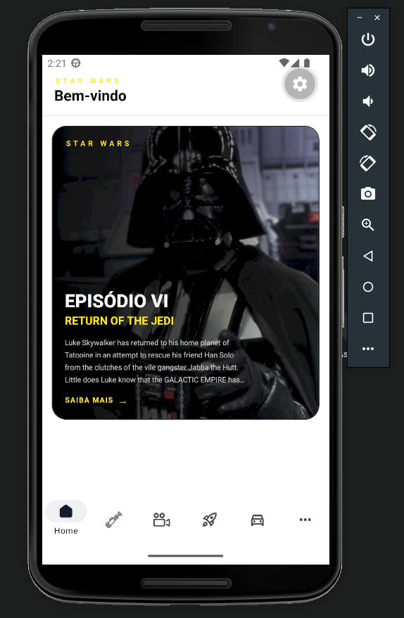
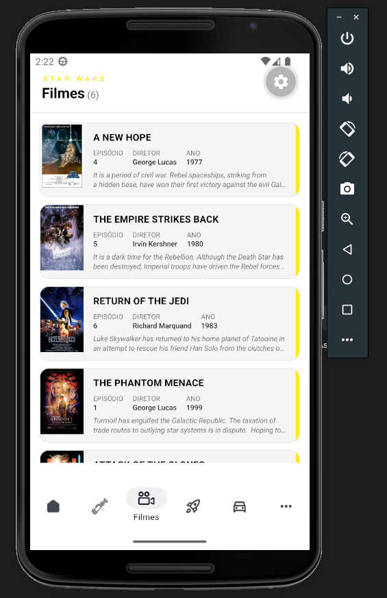

<h1 align="center">
  Star Wars App
</h1>

<p align="center">
  <a href="#participants">Participants</a> •
  <a href="#techs">Techs</a> •
  <a href="#features">Features</a> •
  <a href="#usage">Usage</a>
</p>

<div align="center">
  
  
</div>

## Participants

| [](https://github.com/JoaoFelixx) |
| :-------------------------------------------------------------------------------------------------------: |

| [João Félix](https://github.com/JoaoFelixx) |
| :-------------------------------------------: |

## Techs

- [x] React Native
- [x] Expo (SDK 57) + Expo Router (file-based routing)
- [x] TypeScript
- [x] NativeWind (Tailwind CSS for React Native)
- [x] TanStack React Query
- [x] React Native Reanimated
- [x] Expo Native Tabs
- [x] ESLint + Prettier

## About

Star Wars App is a mobile app built with Expo and Expo Router that consumes the [SWAPI](https://swapi.dev/) (Star Wars API) to let you browse the Star Wars universe: films, characters, planets, species, starships and vehicles.

## Features

- 🎬 Browse all Star Wars films with posters
- 🧑‍🚀 Explore characters, including their images
- 🪐 List planets, species, starships and vehicles
- ⭐ Highlighted film on the Home screen
- 🌓 Light/dark theme support
- 📱 Native tab navigation (Home, Characters, Films, Starships, Vehicles, More)

## How to download the project:

```bash
# Clone the repository
$ git clone https://github.com/JoaoFelixx/star-wars-mobile-app.git

# Enter directory
$ cd star-wars-mobile-app

# Install dependencies
$ npm install

# Run project
$ npm start
```

## Usage

1. Run `npm install`.<br />
2. Run `npm start` and choose how to open the app: on an Android emulator, iOS simulator, the web, or via [Expo Go](https://expo.dev/go) by scanning the QR code.<br />

Other useful scripts:

```bash
$ npm run android   # Run on Android
$ npm run ios        # Run on iOS
$ npm run web         # Run on Web
$ npm run lint        # Lint the project
$ npm run format      # Format the project with Prettier
```

<br/>

<p align="center"> Developed by <a href="https://www.linkedin.com/in/felix-devweb/">João Félix</a> ⚓</p>
